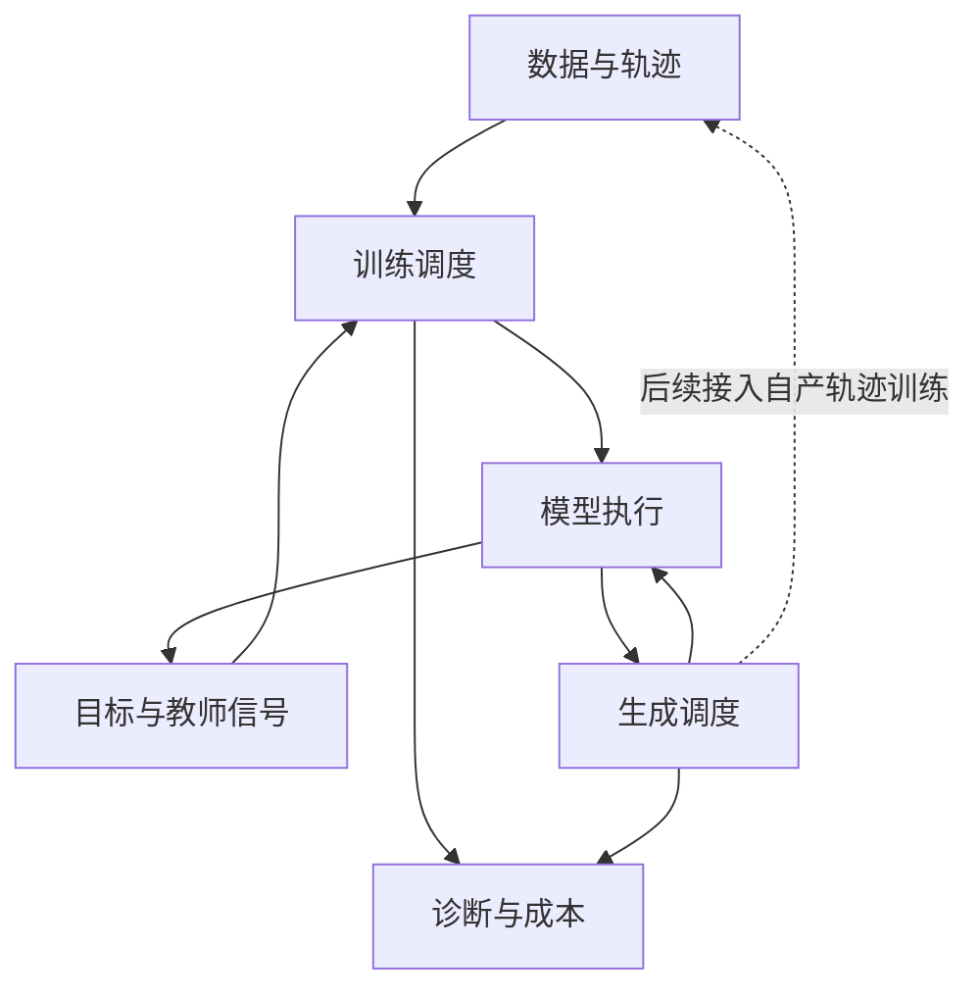

以 TaH2 为主要案例，设计支持内部循环、过程教学和自主生成的后训练框架。先读两条调用链，再看模块职责、状态与接口，最后按边界验收。接入原生循环基座前，先依[后训练主线](https://chatgpt.com/space/page_860625e31d1c8191a35d6ab14da2abbb)填写预训练交接表，再确定可复用的接口和模型专有实现。下文的模块与类型属于设计约定，实际行为以具体代码版本为准。

[返回学习工作台](https://chatgpt.com/space/page_90a0e38077148191b6c40007fbb15133)

# 当前建设目标

先从两个具体请求出发设计框架：训练请求带着问题、已知答案或过程，要求把预测误差变成一次参数更新；生成请求只有当前可见的输入，要求模型自己产生后续 token。两者会调用同一个模型，却以不同方式提供前缀、保留状态和使用输出。第一版要把这两条调用链走通，说明每一步的输入输出、状态归属和梯度路径，再对应到参考源码。这样才能判断一个模块是在实现模型计算，还是在改变训练或生成任务。

# 两条调用链



对一条带解题过程的训练样本，数据模块先编码文本，并标明哪些位置是监督目标。模型根据输入和注意力规则计算各轮状态与读出；目标模块再用标签、mask 和规定的分母构造损失。训练器决定何时反向传播、累积梯度和更新参数。如果目标还需要 lookahead 探测或教师信号，就在目标计算前取得这些量。把职责分开，是为了能单独判断误差来自输入对齐、模型计算、损失定义，还是更新调度，而不必把它们混在同一个 forward 里。

生成时没有现成的正确回答可供输入。先用问题完成 prefill，建立后续计算所需的状态；随后在当前文字位置做内部循环、形成预测，再由采样器选择下一个 token。只有选出的 token 接回输入后，文字位置才向前推进；增加内部循环深度，并不等于多生成一个词。于是，生成记录需要同时保存文字轨迹的来源和内部深度选择，后续蒸馏才能确定学生实际走过哪条路径。

教师查询的困难在于：即使询问的是同一个目标 token，教师看到的前缀不同，给出的条件分布也可能不同。因此接口要明确教师看见哪段前缀、评分哪些位置、返回分布还是特征，并记录参数版本与梯度策略。否则，学生可能在自己的前缀上生成，训练时却无意中接收了另一种输入条件下的目标。先用 SFT 贯通参考路径，再沿明确的教师接口加入 KD 或 OPD；分布式后端和服务优化按实际需要扩展。

# 模块结构

| 模块 | 主要职责 | 对外提供的结果 |
| --- | --- | --- |
| `data/` | 文本编码、分段、监督位置与采样来源 | token 批次、目标、mask 与样本元信息 |
| `model/` | 骨干适配、内部循环、updater、路由、注意力可见性与读出 | 明确类型的预测分布、辅助量及更新后的状态 |
| `objectives/` | 答案或过程损失、教师目标与辅助监督 | 各项损失及各自归一化分母 |
| `train/` | 参数组、前向与目标调用、梯度累积、优化器和保存加载 | 一次可检查的参数更新 |
| `generate/` | prefill、逐 token decode、采样、停止与状态推进 | 自产轨迹及执行记录 |
| `diagnostics/` | 按阶段、位置和深度记录必要的计算与资源开销 | 不携带训练计算图的诊断摘要 |

表中的目录先表示职责，不要求一开始就拆成很多文件。模型模块回答“给定这些状态，怎样继续计算”，目标模块回答“这些输出怎样计分”，训练器回答“何时据此更新参数”。有了这样的边界，更换监督方法时就能判断是否只需改动目标；更换骨干时，也能看清哪些目标仍然适用。第一版采用一种骨干适配和一种明确的循环实现，之后再扩展，并保留替换基座与循环位置的能力。

# 状态与接口的关键约定

假设模型在当前 token 上完成了一轮计算，现在要决定是否继续。只返回 hidden 向量还不够：下一轮可能需要原始 embedding，注意力还需要知道当前位置、当前深度、哪些位置仍在活动，以及各份 K/V 来自哪里、在什么范围内有效。这些量共同决定后续计算能读取什么。因此，循环状态要完整描述这些依赖；模型规定位置与注意力规则，后端负责存储和执行，不能由缓存容器自行猜测模型含义。

同样是“再执行一轮”，它可能属于需要反传的训练主路径，也可能只是为构造标签而做的辅助试算，还可能是部署时的自主生成。三者看起来都在调用循环块，对计算图和状态的要求却不同。分别提供入口，就是要让调用方明确知道：这次调用产生的状态归谁使用，是否保留跨轮计算图，以及梯度能够回到哪里。

例如，lookahead 为了判断继续计算是否有益，会从当前状态试算下一轮。如果它直接写入主路径的可变缓存，主路径随后读到的就不再是探测前的状态，比较对象已经被探测本身改动。因而探测应使用独立的增量状态，可以共享只读前缀，却不能改写主缓存。这里有两个独立问题：关闭梯度决定是否建立求导路径，隔离状态决定是否留下写入副作用；no_grad 只解决前一个问题。

模型返回一个浮点张量后，损失模块仍需知道它表示什么。logits 需要归一化成概率，已经得到的概率或 log-probability 则应按其含义使用；把它们当成同一种对象，可能重复归一化并改变训练目标。跨轮组合是否完成也必须明确，否则目标模块无法判断拿到的是某轮读出还是最终混合。因此输出类型要携带这些信息，并把硬路由、连续混合权重和停止梯度的监督目标分别标注。后端可以融合计算，无须默认构造完整词表的诊断张量。

训练和生成的执行方式通常不同：训练便于同时计算多个监督位置，生成则逐个接入自己采样的 token。要确认两者实现的是同一模型，就先在同参数、同前缀及相应路由条件下，核对位置、注意力和跨轮输出组合的定义，再比较预测结果。参考实现的作用是让每一步依赖都可检查；优化后端可以改变存储和调度，但替换时仍要保持这些数学定义。

# 第一版接口约定

沿着请求的流转来看，下表的对象各自保住一类信息：`Batch` 说明模型实际看见什么、哪些位置要计分；`LoopState` 说明计算进行到了哪里；`Prediction` 说明返回的数值该怎样解释。教师目标、rollout 记录和更新状态则分别连接监督、自产轨迹与参数版本。如果这些信息只散落在调用方的局部变量里，单独替换一个模块就容易改变其他环节的含义。接口因此先约定对象及其约束，初版仍可放在少数文件中；这些名称属于拟实现框架，不表示参考仓库已提供同名类。

| 对象 | 核心字段或形状 | 使用时的约束 |
| --- | --- | --- |
| `Batch` | `input_ids / labels / attention_mask [B,T]`、labels_alignment、样本与来源ID | 明示unshifted或next_token；适配器按模型契约只对齐一次。TaH2内部移位与Huginn预对齐分开，分母统计对应实际目标 |
| `LoopState` | 原始 embedding、当前 hidden、位置、深度、活动集合、KV 与有效范围 | 明确主路径、探测和生成的状态所有权；记录可变别名与跨轮梯度 |
| `Prediction` | `kind`、词表支持、位置、数值张量；full／target-only／selected-token | 区分原始 logits、log-probability 与混合概率；消费者不能猜字段语义 |
| `TeacherRequest / Targets` | 教师前缀、目标位置、token IDs 或特征对齐、版本 | 目标空间与 tokenizer 一致；detach 与显式教师任务梯度分别配置 |
| `RolloutBatch` | response、mask、group、停止原因、采样设置、权重版本及所需行为概率 | 文字前缀、内部路由与采样分布分别追溯 |
| `UpdateState` | optimizer step、模型与组件版本、实际参数组及本次／下一次 LR、scheduler 索引与 horizon、数据游标、随机状态及 checkpoint | 每次同步关联实际参数版本；日志中的推进后 LR 不替代本次更新 LR；恢复能力按保存字段与回读结果判断 |
| `EvalRecord` | 有序样本出现 ID、batch 索引、实际 DP／TP、batch size、U_D、V_E、分子、原始 loss_sum、显示 loss 与 loss_kind | 分子分母对应同一实际监督范围；保留 pad 重复与遗漏；零执行标记不可评估；TP 副本不重复计数 |
| `SourceRecipe` | paper/source/code revisions、源顺序、weight_unit、weight、formatter、过滤与长度策略、tokenizer与packing配置 | 区分文件复用倍率、接受token quota与监督比例；历史配方和当前发布清单分别固定 |
| `DataResumeState` | active消费前source cursor、packer pending、token credits、RNG、popping_idx与rank／布局 | 重建active槽；后台较新游标不能替代其起点；未消费prefetch槽可丢弃重算 |
| `CheckpointIdentity` | repo、完整 revision、代码／依赖、文件摘要、骨干与侧组件清单 | 区分 Hub 元数据、已验证字节与已加载张量；TaH2 四版本入口见生成课 |
| `ConfigOverride` | 保存配置、显式字段集合、修改前后差异及最终组件配置 | 仅允许集合内字段变化；拷贝完整配置后覆盖；字典替换语义和 loader 的 strict=False 报告需单列 |

`EvalRecord` 要保存样本、mask、分子和分母，是因为一个显示出来的验证 loss 本身不能说明究竟统计了哪些目标。更新状态也一样：调度器输出的学习率，只有真正进入本次更新，才是参数使用的学习率。这些拟加入的诊断返回值尚未由固定发布库提供。[T12 与八组可运行检查](https://chatgpt.com/space/page_d887d8f1a41881918ecff055e7613c9c#b445b124-6da5-430c-896a-5b1c0faf4646)给出统计核对方法，[参数组和调度](https://chatgpt.com/space/page_6a7d786183d0819192c20a043a45d647#673e822e-b486-411f-9aee-6fe5de3c2e6c)定位实际使用这些值的执行点。分布式统计还要求所有参与 rank 按相同顺序调用 collective。

并非每个目标都需要模型返回完整词表张量。硬标签 NLL 需要目标词的概率，某些教师查询只需要选定 token 的概率；接口应能直接表达这些查询。先在小规模参考计算中保留完整读出，可以检查跨轮混合与归一化是否正确。确认目标后，再用融合归约、target gather 或 selected-token gather 减少大词表的中间计算。这里优化的是取得所需数值的方式，不能同时省掉目标本来依赖的概率量。

## 用完整语义配置标识模型执行

权重相同，还不能回答“一次请求会怎样执行”。同一个问题若使用不同模板、KV 可见性、路由或深度读出，后续计算的输入条件就可能不同。为了逐项比较这些选择，把一次执行表示为下面的元组。它的用途不是给模型另取一个名字，而是说明：更换训练入口、生成入口或优化后端时，哪些条件必须一起保留。各字段对应固定 TaH2 实现中会影响输出的分支，也是框架拟保存的配置：

```math
\mathfrak S=
(\theta,\mathcal T,\mathcal P,\mathcal V,U,D,
M,\mathcal R,\mathcal W,\epsilon,\mathcal Q).

```

其中 θ 是模型参数，T 固定 tokenizer 与模板，P 固定逻辑位置，V 固定 KV 可见性；U 与 D 分别指定 updater 和实际生效的 decider，M 是最大循环深度。R 指定实际路由规则及 override，W 指定深度读出方式，epsilon 是数值下限，Q 是计算和累计精度。比较自主生成时，还需固定温度、top K／top P、EOS、长度边界及资源约束下的强制停止规则。因此，仅记录权重目录或类名，还不足以确定一次执行。

| 接口 | 需要显式返回或固定的语义 | TaH2 对应证据 |
| --- | --- | --- |
| Prediction | 支持 token ID、位置、混合前后状态，以及归一化是否完成 | target-only 的末维 1 是一个目标值；全词表非 TP loss 与 TP NLL 的归一化分支不同 |
| LoopState | 原始 embedding、活动位置、真实继续标记、逻辑位置与各深度 KV | side pass 使用隔离 snapshot；checkpoint 重计算使用只读缓存 |
| Route | 原始 gate logit、实际继续布尔值、override 来源 | 深度重放只改布尔决定；连续混合仍使用原 gate logit |
| Generator | 实际生效 decider、读出模式、阈值与采样阶段 | HF 与 MiniSGL 的 even_mix 执行深度规则不同；DUO prefill 与 sample decode 也不同 |

[概率与归约详解](https://chatgpt.com/space/page_6a7d786183d0819192c20a043a45d647) · [状态与路由详解](https://chatgpt.com/space/page_31a843d260588191a252ae63fa65f811) · [生成后端边界](https://chatgpt.com/space/page_0626be2568f8819187b536e037f9a6a9)。源码入口是 [`TaHForwardRuntime`](https://github.com/thu-nics/TaH/blob/78ddf9a2c25713fced03a736c5746161f6ee590c/tah2/model/tah_runtime.py#L520-L682) 与 [`forward_mixed_tah_dispatch`](https://github.com/thu-nics/TaH/blob/78ddf9a2c25713fced03a736c5746161f6ee590c/tah2/minisgl/engine/engine.py#L440-L578)。

有了这个元组，后端是否可替换就变成一个具体问题：它是否仍按同一组定义计算。接入原生 loop 基座时，也先写清它自己的 V、U、D、W 和状态初始化，再看 TaH2 的哪些接口能够沿用。这样比较的是输入、状态更新和读出的对应关系，而不是仓库里是否都存在一个叫 loop 的模块；相同名称不会自动给出相同条件分布。

## 路由事件、预测器与服务状态的类型约束

随机路由还会产生一个更隐蔽的接口问题：执行到某个深度的概率，不一定等于这一轮读出在最终文字分布中的权重。沿 T9 既定条件下的二轮单 token 例子，g 是续算概率，q₁、q₂ 是各轮读出，D 是实际停止深度。有 Pr(D=2)=g；但已经执行两轮时，返回的预测仍是 P₂=(1−g)q₁+gq₂。只执行一轮时返回 q₁；把这两种情况按各自发生概率加权，得到 P̄=(1−g²)q₁+g²q₂。因此，g 描述执行事件的概率，P₂ 描述给定路线的预测，P̄ 描述对路线平均后的预测，接口不能用同一个浮点字段混指三者。[完整推导与 T9](https://chatgpt.com/space/page_31a843d260588191a252ae63fa65f811)

| 接口约束 | 具体要求 | 消费者 |
| --- | --- | --- |
| RouteEvent | 分开保存 raw_decision、executed_decision、override_reason；概率仅对应真正随机事件 | 重放、联合策略梯度、成本诊断 |
| PredictionCondition | 明确 given_route、joint_route_text 或 text_marginal；记录入态、route history 和归一化 | CE/KD/PPO/DPO 目标选择 |
| RuntimeState | 服务批次顺序、页池容量、资源覆盖及随机数与逻辑请求对应 | 生成等价、压力评测、恢复 |
| CostTrace | 用真实访问与物理调用计费；不要从边缘混合系数推断执行概率 | 预算门控与能力—成本比较 |

上表将这一区别落实为拟实现的类型约定，固定 TaH2 尚未提供同名类。T9 先在单 token、有限深度下核对代数关系；扩展到完整文字序列时，先前走过的分支还会留下不同 KV，影响后续 token 的预测。因此需要像 T6 那样保留各分支的 KV 和深度历史后验，不能只把当前几项读出平均。服务执行条件见[生成](https://chatgpt.com/space/page_0626be2568f8819187b536e037f9a6a9)和[分布式评测](https://chatgpt.com/space/page_d887d8f1a41881918ecff055e7613c9c)页。目标模块应明确请求联合分数、给定路线的分数或文字边缘分数，而不是根据 tensor 名称猜测。

## 收益诊断接口保留干预对象

知道输出是什么之后，才能问继续一轮究竟带来了什么收益。某轮读出上的目标概率提高，只衡量这一个分量；最终预测还受混合权重影响，整组目标又可能受到其他位置续算的影响。因此，单轮读出、最终混合和整组目标的变化应分别记录。算法 T10 为这些比较固定输入、缓存和干预对象，下表将其写成拟接入的诊断字段；它们属于框架设计，作者仓库尚未提供同名 API。[数学定义与算法 T10](https://chatgpt.com/space/page_31a843d260588191a252ae63fa65f811)

| 记录项 | 必须包含的语义 | 错配时会改变什么 |
| --- | --- | --- |
| `gain_kind` | raw_ce／local_mixed_nll／set_mixed_nll；三者分别保存 | 同号不保证排序或覆盖比例相同；局部目标不包含全部后续影响 |
| `counterfactual_scope` | frozen_prefix_one_boundary；固定的输入、KV、参数、目标、gate 与终止深度 | 不能把局部图重跑解释成整段重新生成或全策略优化 |
| `snapshot` | 混合累加前的 A、R，当前轮目标概率 a，gate g，下一轮输入 X，较浅 KV，原位置索引，早停位置的最终概率 | 混合累加后已吸收尾质量的 buffer 不能直接充当 A；缺少 a 无法恢复立即停止预测器 |
| `intervention_set` | 真实继续 C、追加集合 S、普通 DUO 或 posterior mask、待统计目标 I | posterior 同时得到 singleton 查询；联合续算必须重算 C∪S 的实际依赖图 |
| `execution_record` | 每次独立缓存生命周期、实际转发范围、collective 顺序、参考与实际 dtype 误差 | 防止上次运行的新 KV 污染下次对照；实际成本不能由局部收益自动推定 |

要回答“让这个位置多算一轮是否有益”，两次计算必须从同一快照出发，固定目标集合，并明确只改变哪项决定。否则，缓存或目标一起变化，测到的差值就无法归给这次续算。在既定理论条件下，先核对单位置查询（singleton）和混合恒等式，再比较整组损失与双位置交互（pair），才能看出局部影响能否组合。诊断记录的 gain 用于提出后续实验；它本身不自动修改参数、训练标签或部署策略。

# 边界验收与扩展顺序

| 接口边界 | 后续必须留下的证据 |
| --- | --- |
| 数据到模型 | 同一位置的 token、监督标签、attention mask 与移位目标对应 |
| 模型到损失 | 输出支持与概率语义匹配；各分量有明确分母及梯度范围 |
| 主路径到辅助探测 | 探测不会改变主 KV；backward 重算不会重复写缓存 |
| 训练到生成 | 同权重、同前缀、同深度的概率对应，再检查自主路由 |
| actor 到 rollout | 骨干和循环组件均同步；连续两次更新后核对 log-probability |
| 运行到研究结论 | 数据、版本、逐题输出、成本与评分覆盖可追溯 |

第一版先把 SFT 和自主生成贯通，是为了先确认模型能够按约定计算、输出并保存状态。随后接入离线过程监督或 OPD，主要增加教师目标与查询；接入 RLVR，则通过奖励接口使用同一批 rollout 记录；偏好优化单独消费成对数据。每次切换训练技术，都应明确新目标及其所需数据。之后替换分布式后端时，保持已经选定的位置、读出和损失定义，只改变存储与执行方式。

[工作台十二项路线](https://chatgpt.com/space/page_90a0e38077148191b6c40007fbb15133)将这些接口对应到八个主题页。记忆扩展优先明确历史状态的读取、写入、保留和失效；数据配比扩展优先明确采样单位、来源比例和训练预算。具体机制继续由对照与干预检验。

# 第一版的完成标准

第一版分两步验收：结构阶段明确模块职责、两条调用链和状态接口；实现阶段检查监督位置、概率语义、缓存副作用、预期梯度、训练与生成的一致性，以及保存加载。方法是否有效由后续实验判断。当前任务是框架结构建设，尚未启动新训练。

旧模型、旧数据划分与旧实验计划可以重新选择。历史记录保留用于追溯；本页持续维护当前框架设计。

2026 年 11 月 5 日的调整明确了这一点：当前架构不再以已有实验的模型、数据、方法和训练配方为前提，而是先确定需要支持哪些计算，再组织实现。TaH2 是主要工程参考，verl 等外层训练框架按接口需要继续学习。

# 源码与资料入口

- [研究进展总览入口](https://chatgpt.com/space/page_e25611bb2c00819195e9c2f172dda6da)：项目当前结论与中央交接的原入口。

- [历史实验审阅](https://chatgpt.com/library?file_id=libfile_a90ac85ecfb88191985c7ae410c74ac0&account_id=personal)：作为历史资料保留，当前结构设计不以这些实验或冻结配方为前提。

- [原研究任务书](https://chatgpt.com/library?file_id=libfile_746d702f0c708191bdd446def025e898&account_id=personal)：保留原始设想、竞争路线与实验选择。

- [TaH 官方仓库](https://github.com/thu-nics/TaH)与[TaH2 原论文](https://arxiv.org/html/2609.35748v1)：学习循环模型、在线监督与推理引擎如何衔接；每次源码阅读注明所用版本。 完整主结果、消融、预算推导与原文逐项覆盖见[TaH2 论文结果与实现](https://chatgpt.com/space/page_51505cd26b54819180fb3ee0632da7bb)。

- [verl 控制流与计算流指南](https://verl.readthedocs.io/en/latest/hybrid_flow.html)和[OPD 文档](https://verl.readthedocs.io/en/latest/algo/opd.html)：学习轨迹生成、教师评分和更新调度。后续整合时检查模型调用、缓存、权重同步和轨迹版本。

## 基础材料与研究设想

[可选基础材料：Full-CoT 从输入到一次参数更新](https://chatgpt.com/space/page_40d82c92ebc48191b0bf707bb236c682)

需要补充因果移位、监督 mask 或梯度知识时，可先读这份基础材料，再回到调用链。

[研究设想与框架需求](https://chatgpt.com/space/page_20c2cfeb37588191a19c0b427e4b1f67)

保留自蒸馏、接口与门控、OPD、少量文字记录、动力学尺度和中间状态重用等想法，作为框架应能逐步支持的研究问题。

# 协作方式

按数学模型、参考算法、源码实现的顺序学习。每个模块先定义输入输出、状态和目标，再解释推导条件与梯度估计，随后给出完整算法步骤。

源码讲解要明确张量形状、dtype、索引与mask、detach、缓存副作用、梯度归约和权重同步。原始目标、训练代理目标与执行优化分别说明；用数学不变量和小规模数值对照检查对应关系。

教学简化、项目观察、机制解释和未运行方案分别注明。原始 idea 保留，但不自动转成实验队列；文献按当前问题补充，不以论文数量或文档页数衡量进展。
